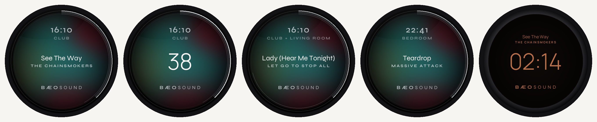

# BæoSound

A B&O Essence–inspired Sonos controller for a 480×480 round ESP32-S3 knob display
(ST7701S RGB panel, CST816 touch, rotary encoder), running ESPHome 2026.9 + LVGL 9.



<sub>Rendered from the firmware's own layout values, fonts and colours (`docs/render_screens.py`), not screen captures; the album art is a stand-in.</sub>

## Two remotes, one source
| Device | Drives | Volume |
|---|---|---|
| `rotary-display-1` (10.0.1.122) | Club | moves every room grouped with Club by the same amount |
| `rotary-display-2` (10.0.1.50) | Bedroom | Bedroom only |

`tt/assemble.py` builds both from the same files; only the identity and the `player`, `room_name`, `group_vol` and `has_tv` substitutions differ.

## Screens
- **Now playing (Nocturne)**: smoked glass over a soft blur of the current album art. Clock, then the room (and who it is grouped with), title and artist in the middle, a thin volume ring round the edge and a fainter track-progress hairline just inside it. When Club is on the TV input it shows the Plex / Google TV title and poster, or "ABC" for iview.
- **Pick to play**: with nothing playing, any touch, turn or press (and waking the night clock by hand) shows three little LPs with cover art: PDM London 2026, PDM Welcome to Paradise, Dimitri In The House Of Love, Dimitri Boiler Room, Gay FM. Turn or swipe to browse, tap a side LP to bring it in, press or tap the middle one to play, hold to go back. It closes itself after 20 s or when music starts. The picks live in `script.rotary_play` and `tt/covers/`.
- **Volume**: turning the knob swaps the title for a large volume numeral and lights the ring.
- **Idle**: after 3 minutes the face dims if music is playing, otherwise a dim amber Manrope clock on near-black at *Night Brightness* ([spec](docs/BaeoRemote%20Face%20A%20Spec.pdf)).

## Controls
| Input | Action |
|---|---|
| Turn | Volume (hold + turn = scrub) |
| Press | Play / pause (nothing to resume: open Pick to play) |
| Double press | Next track |
| Triple press | Previous track |
| Hold (0.8 s, then let go) | Stop music on every speaker (a Sonos on its TV input is left alone) |

Actions show a short line in place of the artist ("NEXT", "LET GO TO STOP ALL", "ALL MUSIC STOPPED"). Screen taps only wake the display. The work-alarm popup comes from the base config and is unchanged.

## Layout
- `rotary-display-1.yaml`: the original device config. It provides the display/SPI setup, alarm popup, numbers and base settings.
- `tt/body.yaml`, `tt/tail.yaml`: the BæoRemote scripts, fonts, sensors and LVGL page.
- `tt/assemble.py`: splices them into `rotary-display-1.new.yaml` and `rotary-display-2.new.yaml` (generated, git-ignored).
- `ha/rotary_remote.yaml`: the Home Assistant package with `script.rotary_volume` (group volume) and `script.rotary_stop_all`. Lives in `/config/packages/`.
- `docs/`: night-face spec, screen renders and the script that makes them.

## Build
```bash
cp secrets.example.yaml secrets.yaml   # fill in
python tt/assemble.py            # or: python tt/assemble.py 2
esphome run rotary-display-1.new.yaml --device 10.0.1.122 --no-logs
esphome run rotary-display-2.new.yaml --device 10.0.1.50 --no-logs
```
Deploying to Home Assistant's ESPHome add-on means copying each `.new.yaml` over `/config/esphome/rotary-display-N.yaml`. The add-on's `secrets.yaml` needs the `rotary_*` and `rotary2_*` keys.
